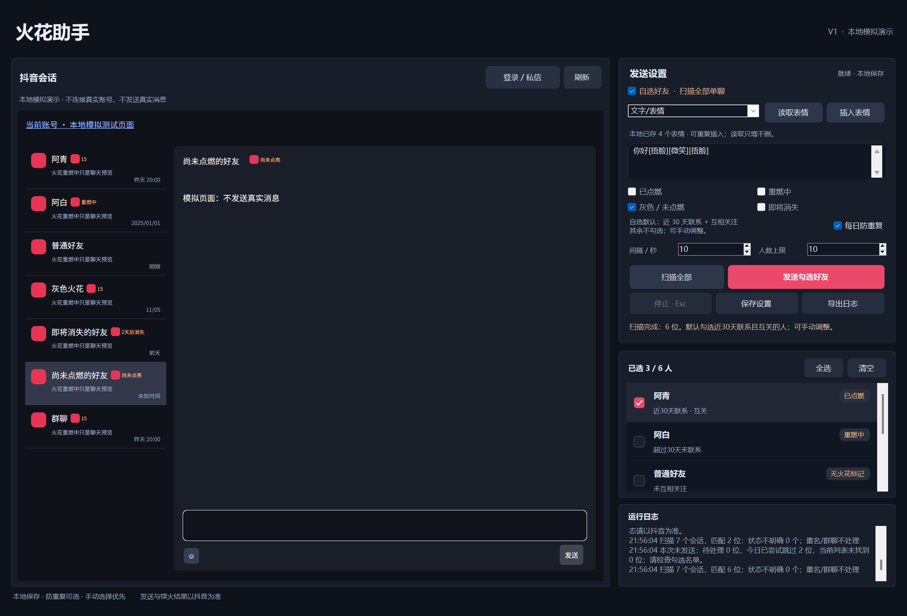

# 火花助手桌面版 V1

Windows 独立桌面应用，使用 WinForms + Microsoft Edge WebView2 显示抖音官方网页。



## 功能
- 扫描已点燃、重燃中、灰色 / 未点燃、即将消失的火花会话。
- 自选好友：扫描可识别的单聊，只给勾选的人发送。
- 默认勾选近 30 天联系且互关的好友，其余可手动选择。
- 支持自定义文字、连续插入 `[捂脸]` 等官方自带表情、发送单个收藏表情包。
- 发送设置合并为“文字/表情”和“收藏表情包”，纯文字直接在“文字/表情”输入。
- 自带表情首次读取后保存本地文件，重启直接使用；再次读取只添加新表情，旧表情保留。
- 勾选好友发送任务结束后，右下角日志显示本批点击发送、跳过及未找到人数。
- 好友名单采用平滑像素滚动和可见行绘制，日志区域加高。
- **每日防重复可选**：默认开启，取消后允许当天再次手动发起发送；设置会保存。
- 关闭也保留发送记录，重新启用即按已有记录防重复。
- 扫描后列表回顶；支持发送间隔、人数上限、停止按钮与 Esc。

## 安装运行
解压 Windows x64 发布包，双击 `火花助手.exe`，旁边 DLL 必须保留。
需要 Windows 10 / 11 x64、.NET Framework 4.8、Microsoft Edge WebView2 Runtime。
首次使用在软件内官方页面登录，编辑内容、扫描并勾选好友后发送。详见 `开始使用.txt`。

## 分发包不含已登录账号
源码、可执行文件和截图均不包含真实抖音登录资料、Cookie、个人消息配置、好友名单或用户表情缓存。
运行时资料只在当前 Windows 用户的 `%LOCALAPPDATA%/SparkDesk`，与安装目录分开。
发布脚本只允许明确列出的程序和源码文件，不遍历用户资料目录。
测试使用独立临时资料和合成会话，截图也来自模拟页面。
其他电脑解压后需自行登录；原电脑更新程序继续使用本机资料，不删除现有登录。
自带表情缓存在 `%LOCALAPPDATA%/SparkDesk/builtin-emoji-cache.json`，只包含公开表情代码和缩略图地址，不保存收藏表情包或账号信息。

## 从源码构建（Windows x64）
需要 Python 3.10+、Node.js、npm 和 Windows .NET Framework 编译器。
在此源码目录执行：

```powershell
python -m pip install -r requirements.txt
python bootstrap.py
npm install
python build.py
npm test
$exe = Join-Path $PWD 'release/火花助手桌面版/火花助手.exe'
$report = Join-Path $PWD 'native-selftest.json'
& $exe --self-test --report $report | Out-Null
python package.py
```

`bootstrap.py` 下载 `sdk-source.json` 中固定的微软官方 NuGet SDK，校验 SHA256。
测试使用本机 Microsoft Edge，不登录、不发送真实消息。
构建产物在 `release`；全部测试通过后，可执行分发 ZIP 和干净源码 ZIP 在 `dist`。
`--demo` 可打开模拟界面；正常运行不是演示模式。

## V1 验证范围
81 项引擎测试与 44 项原生检查覆盖：自动 / 自选、文字 / 表情、默认过滤、
每日防重复开启 / 关闭 / 重新启用、设置保存、旧配置迁移、回顶及最小窗口，
以及批次完成提示、部分跳过、缓存重启加载、只增不删、损坏文件保护和千行名单滚动。
验证是本地隔离测试，不代表真实账号消息送达或火花结果已验证。

## 第三方组件
发布目录 `LICENSE.txt` 仅是 Microsoft WebView2 组件分发许可，不是本项目开源许可证。
WebView2 组件来自微软官方 NuGet 包，未包含完整浏览器运行时。
